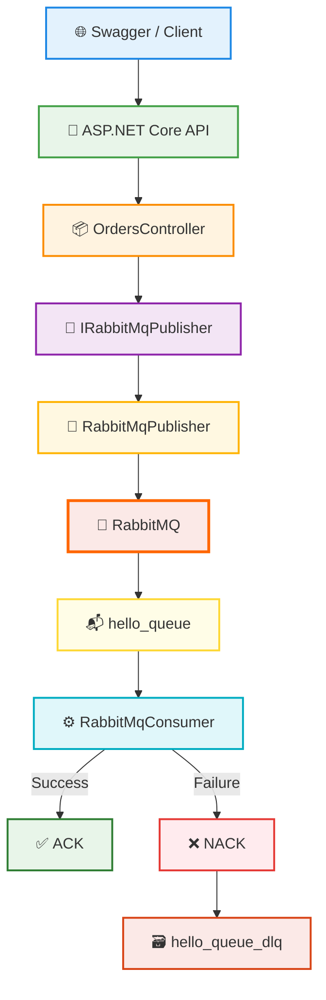

# RabbitMQ ASP.NET Core Messaging Project


A messaging project built with **ASP.NET Core Web API**, **.NET 8**, **C#**, and **RabbitMQ**.

The project demonstrates how an API can publish messages to RabbitMQ and how a separate Consumer application can receive, process, acknowledge, and route failed messages.

---

## 🏗️ Architecture



---

## 📁 Project Structure

```text
RabbitMqProject
│
├── RabbitMqApi
│   ├── Controllers
│   ├── Interfaces
│   ├── Models
│   ├── Services
│   ├── Program.cs
│   └── appsettings.json
│
├── RabbitMqConsumer
│   ├── Models
│   └── Program.cs
│
├── RabbitMqProducer
│   ├── Models
│   └── Program.cs
│
├── .gitignore
├── README.md
└── RabbitMqProject.sln
```

---

## 📦 Projects

### RabbitMqApi

ASP.NET Core Web API used as the main Producer.

Responsibilities:

- Receive order data through HTTP requests
- Publish messages to RabbitMQ
- Serialize C# objects to JSON
- Convert JSON data to byte arrays
- Reuse a shared RabbitMQ connection
- Create channels for message publishing
- Log successful and failed publish operations

### RabbitMqConsumer

Console application responsible for receiving and processing messages.

Responsibilities:

- Listen to `hello_queue`
- Receive messages from RabbitMQ
- Convert byte data to JSON
- Deserialize JSON into `OrderMessage`
- Send `ACK` when processing succeeds
- Send `NACK` when processing fails
- Route failed messages to the Dead Letter Queue

### RabbitMqProducer

A simple Console Producer created during the learning and testing process.

The final application uses **RabbitMqApi** as the main Producer.

---

## 🛠️ Technologies

| Technology | Purpose |
|---|---|
| .NET 8 | Application platform |
| C# | Programming language |
| ASP.NET Core Web API | HTTP API |
| RabbitMQ | Message broker |
| RabbitMQ.Client | RabbitMQ .NET client |
| Swagger / OpenAPI | API testing |
| System.Text.Json | JSON serialization |
| Dependency Injection | Service management |
| ILogger | Application logging |

---

## ✨ Features

- Producer / Consumer architecture
- ASP.NET Core Web API integration
- RabbitMQ message publishing
- RabbitMQ message consumption
- JSON serialization and deserialization
- Durable Queue
- Persistent Messages
- Manual ACK
- Manual NACK
- Dead Letter Queue
- Multiple Consumer support
- Dependency Injection
- Interface-based service structure
- Shared RabbitMQ connection
- Channel-based publishing
- SemaphoreSlim connection protection
- Application logging
- Configuration through `appsettings.json`

---

## 📦 Message Model

```csharp
public class OrderMessage
{
    public int OrderId { get; set; }

    public int UserId { get; set; }

    public decimal Total { get; set; }
}
```

Example message:

```json
{
  "orderId": 4,
  "userId": 9,
  "total": 1260
}
```

---

## 🔄 Message Flow

```text
Swagger / Client
        │
        ▼
ASP.NET Core API
        │
        ▼
OrdersController
        │
        ▼
IRabbitMqPublisher
        │
        ▼
RabbitMqPublisher
        │
        ▼
RabbitMQ
        │
        ▼
hello_queue
        │
        ▼
RabbitMqConsumer
        │
        ├──────── Success ───────► ACK ✅
        │
        └──────── Failure ───────► NACK ❌
                                      │
                                      ▼
                               hello_queue_dlq
```

---

## ⚙️ RabbitMQ Configuration

RabbitMQ configuration is stored in `appsettings.json`.

```json
{
  "RabbitMQ": {
    "HostName": "localhost",
    "QueueName": "hello_queue"
  }
}
```

---

## 📬 Queues

### Main Queue

```text
hello_queue
```

Used for normal order messages.

### Dead Letter Queue

```text
hello_queue_dlq
```

Used for messages that cannot be processed successfully.

---

## 💾 Durable Queue & Persistent Messages

The queue is declared as durable:

```csharp
durable: true
```

Messages are marked as persistent:

```csharp
var properties = new BasicProperties
{
    Persistent = true
};
```

```text
Durable Queue
    └── Keeps the queue definition after RabbitMQ restart

Persistent Message
    └── Marks the message to survive broker restart
```

---

## ✅ ACK

The Consumer uses manual acknowledgement.

```csharp
await channel.BasicAckAsync(
    deliveryTag: ea.DeliveryTag,
    multiple: false
);
```

An ACK tells RabbitMQ that the message was processed successfully.

```text
Message
   │
   ▼
Consumer
   │
   ▼
Successful Processing
   │
   ▼
ACK ✅
```

---

## ❌ NACK

If message processing fails, the Consumer sends a NACK.

```csharp
await channel.BasicNackAsync(
    deliveryTag: ea.DeliveryTag,
    multiple: false,
    requeue: false
);
```

Because `requeue` is set to `false`, the message is not returned to the main queue.

```text
Message Processing Failed
          │
          ▼
        NACK ❌
          │
          ▼
Dead Letter Queue
          │
          ▼
 hello_queue_dlq
```

---

## 🗃️ Dead Letter Queue

The main queue uses Dead Letter configuration:

```csharp
var arguments = new Dictionary<string, object?>
{
    { "x-dead-letter-exchange", "" },
    { "x-dead-letter-routing-key", "hello_queue_dlq" }
};
```

Failed messages are routed to:

```text
hello_queue_dlq
```

---

## 🔌 Connection Management

The API reuses a shared RabbitMQ connection.

```csharp
private IConnection? _connection;
```

If the connection already exists and is open:

```csharp
if (_connection != null && _connection.IsOpen)
{
    return _connection;
}
```

the existing connection is reused.

A new channel is created for each publish operation:

```csharp
using var channel =
    await connection.CreateChannelAsync();
```

```text
Application
     │
     ▼
Shared Connection
     │
     ▼
Channel
     │
     ▼
Publish Message
```

---

## 🔒 SemaphoreSlim

`SemaphoreSlim` prevents multiple requests from trying to create a RabbitMQ connection at the same time.

```csharp
private readonly SemaphoreSlim _connectionLock = new(1, 1);
```

```text
Request 1 ─────► Creates Connection
Request 2 ─────► Waits
Request 3 ─────► Waits
```

After the connection is created:

```text
Request 1 ─────► Releases Lock
Request 2 ─────► Uses Existing Connection
Request 3 ─────► Uses Existing Connection
```

---

## 🧩 Dependency Injection

RabbitMQ publishing operations are accessed through:

```csharp
IRabbitMqPublisher
```

Implementation:

```csharp
RabbitMqPublisher
```

Dependency Injection registration:

```csharp
builder.Services.AddSingleton<
    IRabbitMqPublisher,
    RabbitMqPublisher>();
```

The Controller receives the service through constructor injection:

```csharp
public OrdersController(IRabbitMqPublisher publisher)
{
    _publisher = publisher;
}
```

---

## 🌐 API Endpoint

```http
POST /api/orders
```

Example request:

```json
{
  "orderId": 4,
  "userId": 9,
  "total": 1260
}
```

```text
POST /api/orders
        │
        ▼
OrdersController
        │
        ▼
RabbitMqPublisher
        │
        ▼
RabbitMQ
```

---

## 👥 Multiple Consumers

RabbitMQ can distribute messages between multiple Consumers listening to the same queue.

```text
                     ┌────────────► Consumer 1
                     │
hello_queue ─────────┤
                     │
                     └────────────► Consumer 2
```

This pattern is known as **Competing Consumers**.

---

## 🚀 Running the Project

### 1. Start RabbitMQ

RabbitMQ must be installed and running locally.

```text
localhost
```

### 2. Open RabbitMQ Management UI

```text
http://localhost:15672
```

Default local credentials:

```text
Username: guest
Password: guest
```

### 3. Start RabbitMqConsumer

Run the `RabbitMqConsumer` project.

Expected output:

```text
Consumer mesaj bekliyor...
```

### 4. Start RabbitMqApi

Run the `RabbitMqApi` project and open Swagger.

### 5. Send an Order

Use:

```http
POST /api/orders
```

Example:

```json
{
  "orderId": 4,
  "userId": 9,
  "total": 1260
}
```

### 6. Consumer Output

Example:

```text
Consumer mesaj bekliyor...

Order Id: 4
User Id: 9
Total: 1260
```

---

## 🎯 Purpose

This project was developed to learn and demonstrate the core concepts of RabbitMQ and asynchronous messaging with ASP.NET Core.

Topics covered in the project include:

- Producer
- Consumer
- Queue
- Message Broker
- Connection
- Channel
- JSON Serialization
- JSON Deserialization
- ACK
- NACK
- Dead Letter Queue
- Durable Queue
- Persistent Messages
- Competing Consumers
- Dependency Injection
- Connection Management

---

## 📚 Message Transformation

```text
C# Object
   │
   ▼
JSON
   │
   ▼
Byte Array
   │
   ▼
RabbitMQ
   │
   ▼
Byte Array
   │
   ▼
JSON
   │
   ▼
C# Object
```

---

## 📄 License

This project was created for educational and learning purposes.