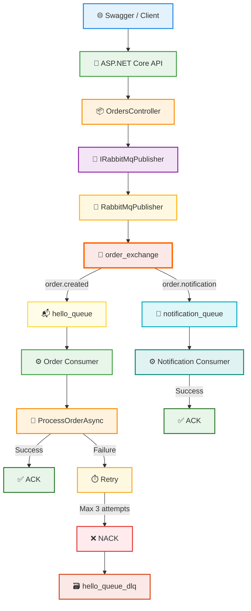

# RabbitMQ ASP.NET Core Messaging Project


A RabbitMQ messaging project developed with **ASP.NET Core Web API, .NET 8, C# and RabbitMQ**.

The project demonstrates message publishing, routing, queue processing, retry mechanisms, dead-letter handling and controlled error management using RabbitMQ.

---

## 🏗️ Architecture



---

## 📁 Project Structure

```text
RabbitMqProject
│
├── RabbitMqApi
│   ├── Controllers
│   ├── Interfaces
│   ├── Models
│   ├── Services
│   ├── Program.cs
│   └── appsettings.json
│
├── RabbitMqConsumer
│   ├── Models
│   └── Program.cs
│
├── RabbitMqProducer
│   ├── Models
│   └── Program.cs
│
├── .gitignore
├── README.md
└── RabbitMqProject.sln
```

---

## 📌 Projects

### 🌐 RabbitMqApi

ASP.NET Core Web API responsible for publishing messages to RabbitMQ.

Main responsibilities:

- Receive HTTP requests
- Publish order messages
- Publish notification messages
- Serialize objects to JSON
- Convert JSON to byte arrays
- Reuse a shared RabbitMQ connection
- Create channels for publishing
- Use routing keys for message routing
- Log successful and failed operations
- Return `503 Service Unavailable` when RabbitMQ cannot be reached

---

### ⚙️ RabbitMqConsumer

Console application responsible for consuming and processing RabbitMQ messages.

It contains two consumers:

```text
Order Consumer
Notification Consumer
```

The Order Consumer:

- Listens to `hello_queue`
- Processes order messages
- Uses a retry mechanism
- Sends ACK after successful processing
- Sends NACK after failed processing
- Routes failed messages to the Dead Letter Queue

The Notification Consumer:

- Listens to `notification_queue`
- Processes notification messages
- Sends ACK after successful processing

---

### 📤 RabbitMqProducer

A simple Console Producer created during the first stages of the project.

It was used to learn and test:

- RabbitMQ connections
- Channels
- JSON serialization
- Message publishing
- Persistent messages

The main Producer in the final architecture is **RabbitMqApi**.

---

## 🛠️ Technologies

| Technology | Purpose |
|---|---|
| .NET 8 | Application platform |
| C# | Programming language |
| ASP.NET Core Web API | HTTP API |
| RabbitMQ | Message broker |
| RabbitMQ.Client | RabbitMQ .NET client |
| Swagger / OpenAPI | API testing |
| System.Text.Json | JSON serialization |
| Dependency Injection | Service management |
| ILogger | Application logging |
| SemaphoreSlim | Connection synchronization |

---

## ✨ Features

- Producer / Consumer architecture
- ASP.NET Core Web API integration
- RabbitMQ Direct Exchange
- Routing Keys
- Multiple Queues
- Multiple Consumers
- JSON serialization and deserialization
- Durable Queues
- Persistent Messages
- Manual ACK
- Manual NACK
- Retry mechanism
- Retry delay
- Dead Letter Queue
- Prefetch / QoS
- Dependency Injection
- Interface-based service structure
- Shared RabbitMQ connection
- SemaphoreSlim connection protection
- Logging
- Controlled `503 Service Unavailable` response
- Configuration through `appsettings.json`

---

## 📦 Message Model

```csharp
public class OrderMessage
{
    public int OrderId { get; set; }

    public int UserId { get; set; }

    public decimal Total { get; set; }
}
```

Example:

```json
{
  "orderId": 4,
  "userId": 9,
  "total": 1260
}
```

---

## 🐇 Direct Exchange

The project uses a Direct Exchange:

```text
order_exchange
```

The API publishes messages to this exchange.

RabbitMQ routes each message according to its routing key.

```text
                       ┌── order.created ───────► hello_queue
order_exchange ────────┤
                       └── order.notification ──► notification_queue
```

---

## 🔑 Routing Keys

Two routing keys are used:

```text
order.created
order.notification
```

### order.created

```text
order_exchange
      │
      ▼
order.created
      │
      ▼
hello_queue
      │
      ▼
Order Consumer
```

### order.notification

```text
order_exchange
      │
      ▼
order.notification
      │
      ▼
notification_queue
      │
      ▼
Notification Consumer
```

---

## 📬 Queues

### hello_queue

Main queue used for order processing.

```text
order.created
      ↓
hello_queue
      ↓
Order Consumer
```

---

### notification_queue

Queue used for notification messages.

```text
order.notification
        ↓
notification_queue
        ↓
Notification Consumer
```

---

### hello_queue_dlq

Dead Letter Queue used for failed order messages.

```text
hello_queue
    ↓
3 Failed Attempts
    ↓
NACK
    ↓
hello_queue_dlq
```

---

## 🔄 Retry Mechanism

Order messages are processed using a retry mechanism.

A message can be processed a maximum of:

```text
3 attempts
```

Flow:

```text
1st attempt
     │
     ├── Success ──► ACK
     │
     └── Failure
            │
            ▼
        Wait 2 seconds
            │
            ▼
       2nd attempt
            │
            ├── Success ──► ACK
            │
            └── Failure
                   │
                   ▼
               Wait 2 seconds
                   │
                   ▼
              3rd attempt
                   │
                   ├── Success ──► ACK
                   │
                   └── Failure
                          │
                          ▼
                        NACK
                          │
                          ▼
                    Dead Letter Queue
```

The retry delay is implemented using:

```csharp
await Task.Delay(2000);
```

---

## ✅ ACK

When a message is processed successfully:

```csharp
await channel.BasicAckAsync(
    deliveryTag: ea.DeliveryTag,
    multiple: false
);
```

RabbitMQ removes the message from the queue.

```text
Message
   ↓
Consumer
   ↓
Successful Processing
   ↓
ACK
   ↓
Message Removed
```

---

## ❌ NACK

If all retry attempts fail:

```csharp
await channel.BasicNackAsync(
    deliveryTag: ea.DeliveryTag,
    multiple: false,
    requeue: false
);
```

Because:

```text
requeue = false
```

the message is not sent back to the main queue.

Instead, it is routed to the Dead Letter Queue.

---

## 🗃️ Dead Letter Queue

The main queue contains the following Dead Letter configuration:

```csharp
var arguments = new Dictionary<string, object?>
{
    { "x-dead-letter-exchange", "" },
    { "x-dead-letter-routing-key", "hello_queue_dlq" }
};
```

Failed messages are routed to:

```text
hello_queue_dlq
```

---

## 🚦 Prefetch / QoS

The Consumer uses RabbitMQ QoS configuration:

```csharp
await channel.BasicQosAsync(
    prefetchSize: 0,
    prefetchCount: 1,
    global: false
);
```

This means the Consumer can hold a maximum of:

```text
1 Unacked Message
```

at the same time.

Example:

```text
Queue:

Message 1
Message 2
Message 3
Message 4
Message 5

           ↓

Consumer receives Message 1

Ready:   4
Unacked: 1

           ↓

ACK

           ↓

Consumer receives Message 2
```

This prevents the Consumer from receiving too many unprocessed messages at the same time.

---

## 💾 Durable Queues & Persistent Messages

Queues are declared as durable:

```csharp
durable: true
```

Messages are marked as persistent:

```csharp
var properties = new BasicProperties
{
    Persistent = true
};
```

Difference:

```text
Durable Queue
    └── Queue definition survives RabbitMQ restart

Persistent Message
    └── Message is marked to survive broker restart
```

---

## 🔌 Connection Management

The API reuses a shared RabbitMQ connection.

```csharp
private IConnection? _connection;
```

If the connection already exists and is open:

```csharp
if (_connection != null && _connection.IsOpen)
{
    return _connection;
}
```

the same connection is reused.

A new channel is created for each publish operation:

```csharp
using var channel =
    await connection.CreateChannelAsync();
```

Architecture:

```text
ASP.NET Core Application
        │
        ▼
Shared RabbitMQ Connection
        │
        ▼
Channel
        │
        ▼
Publish Message
```

---

## 🔒 SemaphoreSlim

`SemaphoreSlim` prevents multiple requests from creating a RabbitMQ connection at the same time.

```csharp
private readonly SemaphoreSlim _connectionLock = new(1, 1);
```

Example:

```text
Request 1 ───► Creates Connection

Request 2 ───► Waits

Request 3 ───► Waits
```

After the connection is created:

```text
Request 1 ───► Releases Lock

Request 2 ───► Uses Existing Connection

Request 3 ───► Uses Existing Connection
```

---

## 🧩 Dependency Injection

RabbitMQ publishing operations are accessed through:

```csharp
IRabbitMqPublisher
```

Implementation:

```csharp
RabbitMqPublisher
```

Registration:

```csharp
builder.Services.AddSingleton<
    IRabbitMqPublisher,
    RabbitMqPublisher>();
```

Controller injection:

```csharp
public OrdersController(IRabbitMqPublisher publisher)
{
    _publisher = publisher;
}
```

---

## 🌐 API Endpoints

### Create Order

```http
POST /api/orders
```

Routing key:

```text
order.created
```

Flow:

```text
POST /api/orders
      ↓
OrdersController
      ↓
RabbitMqPublisher
      ↓
order_exchange
      ↓
order.created
      ↓
hello_queue
      ↓
Order Consumer
```

Example request:

```json
{
  "orderId": 1,
  "userId": 25,
  "total": 1500
}
```

---

### Create Notification

```http
POST /api/orders/notification
```

Routing key:

```text
order.notification
```

Flow:

```text
POST /api/orders/notification
          ↓
OrdersController
          ↓
RabbitMqPublisher
          ↓
order_exchange
          ↓
order.notification
          ↓
notification_queue
          ↓
Notification Consumer
```

Example request:

```json
{
  "orderId": 2,
  "userId": 25,
  "total": 1500
}
```

---

## ⚠️ RabbitMQ Error Handling

If RabbitMQ cannot be reached, the API catches:

```text
BrokerUnreachableException
```

and returns:

```text
503 Service Unavailable
```

Example:

```text
RabbitMQ Running
       ↓
POST Request
       ↓
200 OK
```

If RabbitMQ is unavailable:

```text
RabbitMQ Stopped
       ↓
POST Request
       ↓
BrokerUnreachableException
       ↓
503 Service Unavailable
```

Example response:

```text
RabbitMQ servisine şu anda ulaşılamıyor.
```

---

## 🧪 Tested Scenarios

The following scenarios were tested during development:

- Successful order publishing
- Successful notification publishing
- Order Consumer processing
- Notification Consumer processing
- ACK behavior
- NACK behavior
- Retry mechanism
- Three failed retry attempts
- Dead Letter Queue routing
- Prefetch / QoS
- Multiple queues
- Multiple consumers
- Direct Exchange routing
- Routing key behavior
- Consumer stopped while messages were published
- Messages waiting in the queue until the Consumer starts
- RabbitMQ service unavailable
- API returning `503 Service Unavailable`
- RabbitMQ restart
- Persistent messages
- Durable queues

---

## ⚙️ Configuration

RabbitMQ configuration is stored in:

```text
appsettings.json
```

Example:

```json
{
  "RabbitMQ": {
    "HostName": "localhost"
  }
}
```

---

## 🚀 Running the Project

### 1. Start RabbitMQ

RabbitMQ must be installed and running locally.

Default host:

```text
localhost
```

---

### 2. Open RabbitMQ Management UI

```text
http://localhost:15672
```

Default local credentials:

```text
Username: guest
Password: guest
```

---

### 3. Start RabbitMqApi and RabbitMqConsumer

Both projects can be configured as multiple startup projects in Visual Studio.

```text
RabbitMqApi       → Start
RabbitMqConsumer  → Start
RabbitMqProducer  → None
```

---

### 4. Open Swagger

Use Swagger to send HTTP requests to the API.

---

### 5. Send an Order

```http
POST /api/orders
```

Example:

```json
{
  "orderId": 4,
  "userId": 9,
  "total": 1260
}
```

Expected flow:

```text
Swagger
   ↓
RabbitMqApi
   ↓
order_exchange
   ↓
order.created
   ↓
hello_queue
   ↓
Order Consumer
   ↓
ACK
```

---

### 6. Send a Notification

```http
POST /api/orders/notification
```

Example:

```json
{
  "orderId": 5,
  "userId": 9,
  "total": 1260
}
```

Expected flow:

```text
Swagger
   ↓
RabbitMqApi
   ↓
order_exchange
   ↓
order.notification
   ↓
notification_queue
   ↓
Notification Consumer
   ↓
ACK
```

---

## 🎯 Purpose

This project was developed to learn and demonstrate RabbitMQ and asynchronous messaging concepts with ASP.NET Core.

The project covers:

- Message Queue concepts
- Producer
- Consumer
- Message Broker
- Exchange
- Direct Exchange
- Routing Key
- Queue Binding
- Multiple Queues
- Multiple Consumers
- Connection
- Channel
- Serialization
- Deserialization
- ACK
- NACK
- Retry
- Dead Letter Queue
- Prefetch / QoS
- Durable Queues
- Persistent Messages
- Dependency Injection
- Connection Management
- Error Handling
- Monitoring

---

## 📚 Message Transformation

```text
C# Object
   ↓
JSON
   ↓
Byte Array
   ↓
RabbitMQ
   ↓
Byte Array
   ↓
JSON
   ↓
C# Object
```

---

## 📊 Final Message Flow

```text
                           ┌────────────────────────────┐
                           │       Swagger / Client     │
                           └─────────────┬──────────────┘
                                         │
                                         ▼
                           ┌────────────────────────────┐
                           │      ASP.NET Core API      │
                           └─────────────┬──────────────┘
                                         │
                                         ▼
                           ┌────────────────────────────┐
                           │      RabbitMqPublisher     │
                           └─────────────┬──────────────┘
                                         │
                                         ▼
                           ┌────────────────────────────┐
                           │       order_exchange       │
                           └──────────┬───────┬─────────┘
                                      │       │
                           order.created      order.notification
                                      │       │
                                      ▼       ▼
                             ┌────────────┐  ┌──────────────────┐
                             │hello_queue │  │notification_queue│
                             └─────┬──────┘  └─────────┬────────┘
                                   │                   │
                                   ▼                   ▼
                           ┌──────────────┐     ┌────────────────────┐
                           │Order Consumer│     │Notification Consumer│
                           └──────┬───────┘     └─────────┬──────────┘
                                  │                       │
                            ┌─────┴─────┐                 │
                            │           │                 │
                         Success      Failure            ACK
                            │           │
                           ACK       Retry ×3
                                        │
                                      NACK
                                        │
                                        ▼
                               ┌──────────────────┐
                               │ hello_queue_dlq  │
                               └──────────────────┘
```

---

## 📄 License

This project was created for educational and learning purposes.