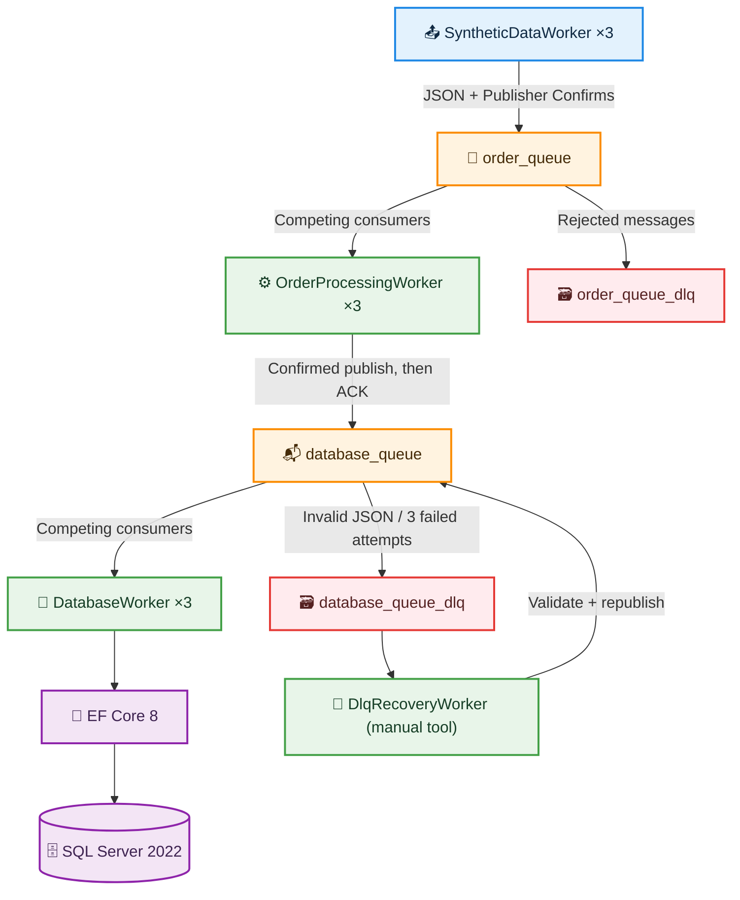
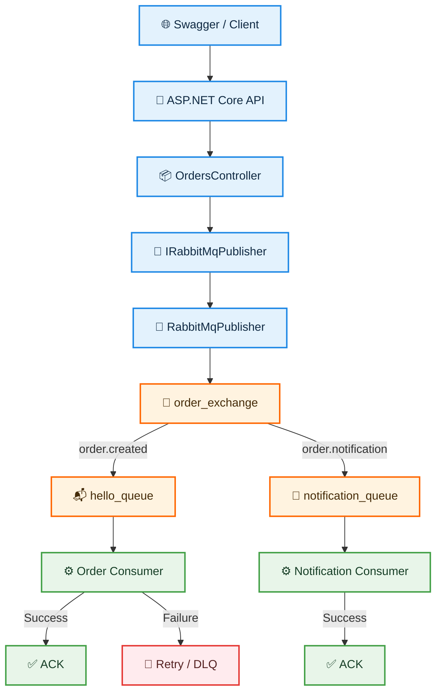
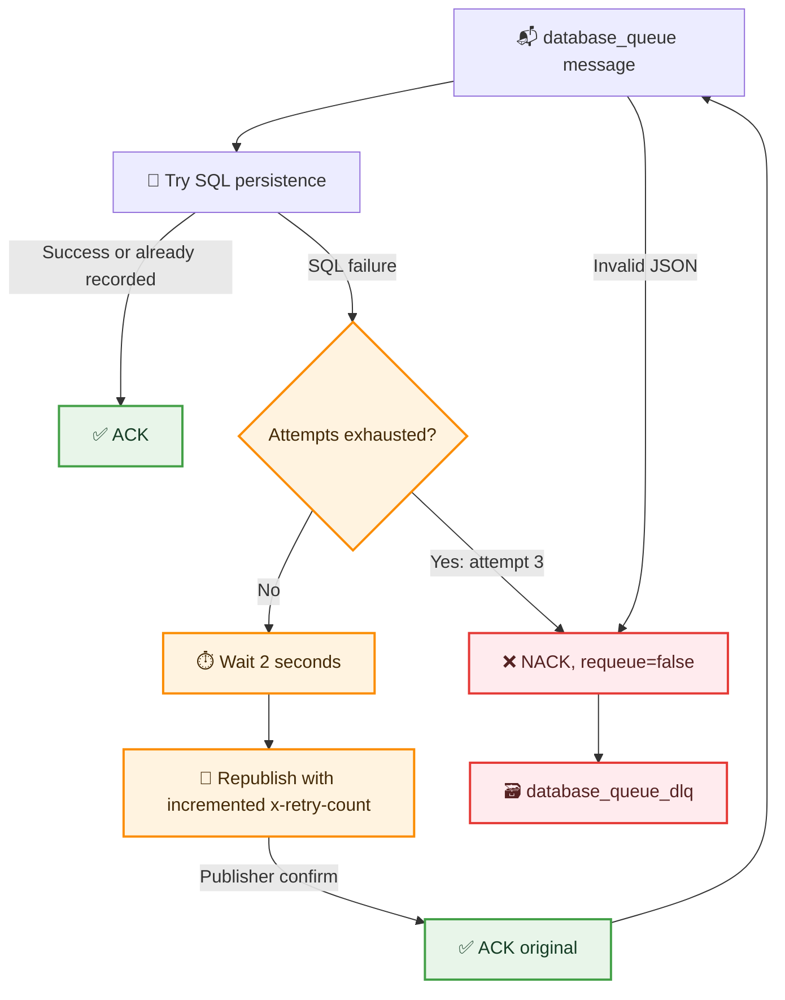

# 🐇 RabbitMQ Distributed Order Processing System


A hands-on **distributed, asynchronous order-processing project** built with **.NET 8, RabbitMQ, SQL Server, Entity Framework Core and Docker Compose**. It started as an ASP.NET Core messaging API and grew into a multi-worker pipeline with retries, dead-letter queues, duplicate protection, recovery tools and load-testing experiments.

> **Two parts of the same repository:** the original **RabbitMqApi / console messaging examples** explore exchanges, routing keys and HTTP publishing. The **distributed worker pipeline** is the newer, Docker-enabled system. They are documented separately because they use different message routes and deployment workflows.

---

## 🏗️ Architecture

### Distributed order-processing pipeline (Docker-enabled)



### Original ASP.NET Core API / routing examples



---

## 📁 Project Structure

```text
RabbitMqProject/
│
├── RabbitMqApi/              # Original ASP.NET Core Web API example
├── RabbitMqConsumer/         # Original console consumer example (if present)
├── RabbitMqProducer/         # Original console producer example (if present)
│
├── RabbitMq.Shared/          # Shared SyntheticOrderMessage model
├── SyntheticDataWorker/      # Synthetic order publisher + Dockerfile
├── OrderProcessingWorker/    # order_queue -> database_queue + Dockerfile
├── DatabaseWorker/           # database_queue -> SQL Server + Dockerfile
├── DlqRecoveryWorker/        # Manual DLQ inspection and recovery
│
├── compose.yaml              # RabbitMQ, SQL Server, and Worker services
├── .dockerignore             # Excludes local build artifacts
├── .gitignore                # Excludes secrets and build artifacts
├── README.md
└── RabbitMqProject.sln
```

The exact location of older example projects may differ in the solution; the worker projects above are the distributed pipeline used for Docker tests.

---

## 📌 Projects

### 📤 SyntheticDataWorker — Producer

Generates `SyntheticOrderMessage` objects with a unique `MessageId`, random order/user values, amount, UTC timestamp and source `WorkerId`. It serializes messages to JSON and publishes to durable **`order_queue`** with persistent delivery mode and publisher confirmations. Its publisher reuses a channel rather than opening a new channel for each message. Production delay is configurable with `WorkerSettings__DelayMilliseconds`.

### ⚙️ OrderProcessingWorker — Intermediate Consumer

Consumes `order_queue` using manual acknowledgments and prefetch/QoS. Valid orders are republished to **`database_queue`** using publisher confirmations; only then is the input message ACKed. Rejected or malformed messages can be dead-lettered to **`order_queue_dlq`**.

### 💾 DatabaseWorker — SQL Consumer

Consumes `database_queue`, deserializes order messages and persists them through **EF Core 8** into `RabbitMqOrdersDb.dbo.Orders`. Each message gets a scoped `DbContext`. A unique SQL index on `MessageId` complements the existing duplicate check. Database failures trigger a **three-attempt retry policy**; the final failure or invalid JSON is rejected to **`database_queue_dlq`**.

### 🔄 DlqRecoveryWorker — Recovery Utility

An operator-run console tool (not a continuously running Compose service). It inspects DLQ messages, identifies invalid JSON, asks for explicit confirmation, republishes valid payloads to `database_queue`, waits for publisher confirmation, and ACKs the DLQ originals afterward. Invalid messages remain unacknowledged and return to the DLQ when the connection closes.

### 🧩 RabbitMq.Shared

Provides the `SyntheticOrderMessage` contract shared across Worker projects.

### 🌐 RabbitMqApi and earlier examples

The original ASP.NET Core API demonstrates HTTP-to-RabbitMQ publishing using controllers, interfaces, dependency injection, Swagger/OpenAPI, a direct exchange (`order_exchange`), routing keys (`order.created`, `order.notification`), and separate order/notification queues. These are **earlier learning examples**, not the HTTP front end of the Docker worker pipeline. API error handling includes a `503 Service Unavailable` scenario when RabbitMQ is unavailable.

---

## 🛠️ Technologies

| Technology | Purpose |
|---|---|
| .NET 8 / C# | Background services and API development |
| ASP.NET Core / Swagger | Original HTTP messaging API and testing |
| RabbitMQ / RabbitMQ.Client | Message broker and client library |
| SQL Server 2022 | Durable order storage |
| Entity Framework Core 8 | Database access, migrations, unique index |
| Docker / Docker Compose | Containerized services and horizontal scaling |
| System.Text.Json | JSON serialization/deserialization |
| Dependency Injection / ILogger | Worker services and diagnostics |
| SemaphoreSlim | Controlled publishing and connection access |

---

## ✨ Features

- ✅ **Multiple producers and competing consumers** — up to 3 instances per worker type in tested deployments
- ✅ **Asynchronous pipeline** — `order_queue` → `database_queue` → SQL Server
- ✅ **Publisher confirms and persistent messages** — confirmed publishing before ACK in forwarding/recovery paths
- ✅ **Durable queues, manual ACK/NACK and prefetch** — controlled message handling
- ✅ **Retry with header-based attempt tracking** — up to 3 database processing attempts
- ✅ **Dead-letter queues** — `order_queue_dlq` and `database_queue_dlq`
- ✅ **Duplicate-message protection** — `MessageId` existence check and a unique SQL index
- ✅ **DLQ recovery utility** — recovers valid messages and retains invalid messages
- ✅ **Docker Compose** — separate broker/database volumes and independently scalable workers
- ✅ **Failure and load tests** — SQL outage, Worker shutdown, RabbitMQ disconnect and backlog analysis

---

## 📦 Synthetic Order Message

```csharp
public class SyntheticOrderMessage
{
    public Guid MessageId { get; set; }
    public int OrderId { get; set; }
    public int UserId { get; set; }
    public decimal Total { get; set; }
    public DateTime CreatedAt { get; set; }
    public string WorkerId { get; set; } = string.Empty;
}
```

Example payload:

```json
{
  "MessageId": "3f6d7e81-9f23-4b98-8a02-524de8a01d11",
  "OrderId": 888888,
  "UserId": 25,
  "Total": 2000,
  "CreatedAt": "2026-10-22T10:00:00Z",
  "WorkerId": "Worker-1"
}
```

The original API example also uses a smaller `OrderMessage` with `OrderId`, `UserId` and `Total`.

---

## 🐇 Exchanges, Routing Keys & Queues

### Distributed pipeline

| Queue | Producer / Consumer | Failure destination |
|---|---|---|
| `order_queue` | SyntheticDataWorker → OrderProcessingWorker | `order_queue_dlq` |
| `database_queue` | OrderProcessingWorker → DatabaseWorker | `database_queue_dlq` |
| `order_queue_dlq` | Rejected processing messages | Manual inspection |
| `database_queue_dlq` | Invalid JSON or exhausted DB retries | DlqRecoveryWorker |

The distributed pipeline publishes to RabbitMQ's **default exchange** (`exchange: ""`) and routes by queue name.

### Original API example

```text
order_exchange
     ├── order.created ───────► hello_queue ───────► Order Consumer
     └── order.notification ──► notification_queue ► Notification Consumer
```

The original examples also include `hello_queue_dlq` for failed messages. These queues are distinct from the Docker pipeline's `order_queue` and `database_queue`.

---

## 🔄 Retry, ACK/NACK & Dead Letter Handling



**How it works:** `x-retry-count` starts at `0`, then increments to `1` and `2`. That corresponds to processing attempts **1/3**, **2/3** and **3/3**. On the third failure, DatabaseWorker sends `BasicNackAsync(..., requeue: false)` and RabbitMQ dead-letters the message. The delay is implemented in the Worker as `Task.Delay(2000, stoppingToken)`.

```csharp
await channel.BasicQosAsync(
    prefetchSize: 0,
    prefetchCount: 1,
    global: false,
    cancellationToken: stoppingToken
);
```

**ACK** confirms successful processing. **NACK with `requeue: false`** rejects a message and, when the queue has the configured dead-letter routing, sends it to DLQ. Acknowledgments are tied to a RabbitMQ channel and delivery tag.

> **Delivery semantics:** The design minimizes message loss but remains **at-least-once** rather than exactly-once. A publish or ACK failure may cause redelivery. A unique `MessageId` index protects the SQL data from duplicate inserts; concurrent duplicate handling and recovery policies should still be reviewed for production use.

---

## 🧪 Tested Scenarios & Observed Performance

| Test | Outcome |
|---|---|
| 3 Producer + 3 processing Consumer + 3 DB Consumer | End-to-end orders stored in SQL Server |
| SQL connection intentionally broken | Database retry count progressed to 3/3 |
| Third failed attempt | Message routed to `database_queue_dlq` |
| Invalid JSON | Rejected and preserved in DLQ |
| Same MessageId published twice | Duplicate check observed; unique index in place |
| Worker terminated before ACK | Unacknowledged message returned to the queue and was later stored |
| RabbitMQ connection force-closed | Client reconnected in local test |
| DLQ inspection | 45 valid messages and 1 invalid message identified |
| DLQ recovery | 45 messages republished, invalid message retained; sample SQL records verified |
| Docker Compose scale-out | 3 instances of each Worker running with RabbitMQ and SQL Server |

### Local performance observations

| Scenario | Observed rate / effect |
|---|---|
| Producers with delay | ~27–28 messages/s at the tested settings |
| Producers without delay | Incoming rate observed above 200 messages/s |
| One processing consumer | ~150 ACK/s observed in one run |
| 3 processing consumers + 1 DB consumer | `database_queue` backlog appeared under higher load |
| SQL persistence | Many thousands of synthetic records stored across local tests |

These numbers are **short-lived observations from a development machine**, not reproducible benchmark guarantees or maximum throughput. RabbitMQ's momentary rates and `Ready`/`Unacked` values change as the queues drain.

---

## 🐳 Running with Docker Compose

### Requirements

- Docker Desktop running in **Linux containers** mode
- Docker Compose
- .NET 8 SDK + `dotnet-ef` 8.x **only if applying migrations from the host**

### 1. Clone and configure

```bash
git clone https://github.com/EkinYildiran/RabbitMqProject.git
cd RabbitMqProject
```

Create `.env` next to `compose.yaml`:

```dotenv
MSSQL_SA_PASSWORD=REPLACE_WITH_A_STRONG_PASSWORD
```

**Never commit `.env` or credentials.** The repository's `.gitignore` should exclude `.env` and `.env.*`. The password is supplied to the SQL Server container and to DatabaseWorker through Compose environment variables.

### 2. Build the three images

Run from the repository root (the final `.` is necessary because the projects reference `RabbitMq.Shared`):

```bash
docker build -f SyntheticDataWorker/Dockerfile -t rabbitmq-producer .
docker build -f OrderProcessingWorker/Dockerfile -t rabbitmq-order-worker .
docker build -f DatabaseWorker/Dockerfile -t rabbitmq-database-worker .
```

Ensure `.dockerignore` excludes `**/bin/` and `**/obj/` to avoid copying Windows-specific NuGet assets into Linux builds.

### 3. Start RabbitMQ and SQL Server

```bash
docker compose config --quiet
docker compose up -d rabbitmq sqlserver
docker compose ps
```

**Service addresses:**

| Service | From Windows host | From another Compose container |
|---|---|---|
| RabbitMQ AMQP | `localhost:5673` | `rabbitmq:5672` |
| RabbitMQ Management | http://localhost:15673 | `rabbitmq:15672` |
| SQL Server | `localhost,1434` | `sqlserver,1433` |

### 4. Apply existing EF Core migrations (first deployment)

The database in the Docker SQL Server volume starts empty. Apply the existing `DatabaseWorker` migration **before starting database consumers**. On Windows PowerShell, with the .NET 8 CLI and `dotnet-ef` 8.x installed:

```powershell
cd .\DatabaseWorker
$env:ConnectionStrings__DefaultConnection = "Server=localhost,1434;Database=RabbitMqOrdersDb;User Id=sa;Password=YOUR_PASSWORD;TrustServerCertificate=True;"
dotnet ef database update
Remove-Item Env:ConnectionStrings__DefaultConnection
cd ..
```

Replace `YOUR_PASSWORD` locally, do not paste it in issues or screenshots, and avoid committing any connection string containing a password. The existing migration creates the `Orders` table and a unique index on `MessageId`.

### 5. Run and scale Workers

```bash
docker compose up -d --scale producer=3 --scale order-worker=3 --scale database-worker=3
```

Expected: **11 running containers** — three producers, three processing workers, three database workers, RabbitMQ and SQL Server.

```bash
docker compose ps
docker compose logs --tail=50 producer order-worker database-worker
```

To stop generation while the queues drain:

```bash
docker compose stop producer
```

Then stop the remaining Worker containers:

```bash
docker compose stop order-worker database-worker
```

Stop all services **without deleting data**:

```bash
docker compose stop
```

> ⚠️ Avoid `docker compose down -v` unless you intentionally want to delete the Docker volumes and stored data.

### 6. Verify SQL records

Connect with SSMS using `localhost,1434`, SQL Server authentication (`sa`), your `.env` password and **Trust server certificate** in the local development environment.

```sql
USE RabbitMqOrdersDb;
SELECT COUNT(*) AS TotalOrders FROM dbo.Orders;
```

---

## 🌐 Original API — Endpoints & Development Workflow

The original API is useful as a standalone RabbitMQ learning module and is **not automatically started by the Docker Compose worker stack**.

| Endpoint | Purpose |
|---|---|
| `POST /api/orders` | Publish an order message |
| `POST /api/orders/notification` | Publish a notification example |

Example API request:

```http
POST /api/orders
Content-Type: application/json
```

```json
{
  "orderId": 4,
  "userId": 9,
  "total": 1260
}
```

For the original workflow, start a local RabbitMQ broker (typically `localhost:5672`) and run the API and related consumer examples through Visual Studio. Swagger provides a convenient HTTP testing interface. An unavailable RabbitMQ broker can lead to a controlled `503 Service Unavailable` response in the API's error handling.

---

## 🔒 Configuration & Safety Notes

- Worker RabbitMQ host: `RABBITMQ_HOST`; local fallback: `localhost`.
- Docker RabbitMQ host: `rabbitmq` (internal network DNS name).
- Docker DatabaseWorker connection: `ConnectionStrings__DefaultConnection`, with SQL Server host `sqlserver,1433`.
- Local Windows DatabaseWorker may use a separate trusted connection configured in `appsettings.json`.
- RabbitMQ default `guest/guest` credentials are appropriate only for a trusted **local development** environment.
- Docker volumes persist broker/SQL state across container stops. The original Windows installations use separate data stores.
- For production, add stronger secret management, health checks, startup readiness checks, monitoring, backoff policies and careful concurrent duplicate handling.
- The `DlqRecoveryWorker` is a manual operation: inspect messages before recovery, and keep an audit trail for sensitive deployments.

---

## 🎯 Purpose

This educational project explores **Producer/Consumer patterns, message brokers, routing, exchanges, channels, JSON serialization, acknowledgments, retry/DLQ patterns, EF Core persistence, duplicate prevention, horizontal scaling and Docker-based deployment**.

## 👤 Author

**Ekin Yıldıran**
Computer Engineering Graduate
GitHub: [EkinYildiran](https://github.com/EkinYildiran)

---

## 📄 License

Created for educational and learning purposes. No specific open-source license is granted unless a license file is added to the repository.
